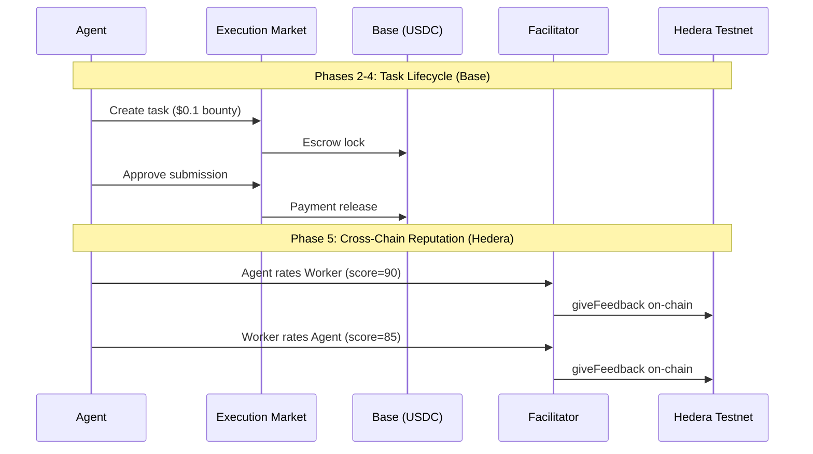

# Golden Flow Hedera Report -- Cross-Chain E2E Test

> **Date**: 2026-04-05 05:53 UTC
> **Payment Chain**: Base Mainnet (chain 8453)
> **Reputation Chain**: Hedera Testnet (chain 296)
> **Facilitator**: https://facilitator.ultravioletadao.xyz
> **Result**: **PASS**

---

## Executive Summary

Full Execution Market lifecycle executed on production:
task created, worker applied, evidence submitted, payment released on **Base** (USDC),
then bidirectional reputation posted on **Hedera Testnet** (ERC-8004).

**Key Result**: Same task, two chains -- payment where the money is (Base),
reputation where the identity lives (Hedera).

---

## Cross-Chain Transaction Summary

| Operation | Chain | TX Hash | Explorer |
|-----------|-------|---------|----------|
| Escrow Lock | Base (8453) | `0xa639694b5ef114ccac...` | [BaseScan](https://basescan.org/tx/0xa639694b5ef114ccac663eb42e9c81d57de6f17704e8d97d122648eb96e03756) |
| Payment Release | Base (8453) | `0xad79de0dc53e0e7d3b...` | [BaseScan](https://basescan.org/tx/0xad79de0dc53e0e7d3b9c15150ab4824bee4a0bd8845d63c524250e672d302168) |
| Agent->Worker Rating | Hedera Testnet (296) | `0xd2ad59b5e175cdcc78...` | [HashScan](https://hashscan.io/testnet/transaction/0xd2ad59b5e175cdcc785a379722168b1719f12634719cd8fb1afa2cd483dbf345) |
| Worker->Agent Rating | Hedera Testnet (296) | `0xad62c2f8e2c043678a...` | [HashScan](https://hashscan.io/testnet/transaction/0xad62c2f8e2c043678ae27a3b6a8fe10eb51dad66beb054b4aedaf5d755566b37) |
| Merit Tip (0.01 HBAR) | Hedera Testnet (296) | `0x9e22b401b84f1e86a4...` | [HashScan](https://hashscan.io/testnet/transaction/0x9e22b401b84f1e86a4a23bbdb529ad0a2b357d2da60f268738aacd27b296ba86) |

---

## Test Configuration

| Parameter | Value |
|-----------|-------|
| Task ID | `b8285e27-b1e8-42a8-9af8-c6a6545e7602` |
| Bounty | $0.1 USDC |
| Worker Net (87%) | $0.0870 USDC |
| Payment Chain | Base Mainnet (chain 8453) |
| Reputation Chain | Hedera Testnet (chain 296) |
| Hedera Agent ID | #100 |
| Facilitator HBAR | 2092.969903 |
| Identity Registry | `0x8004A818BFB912233c491871b3d84c89A494BD9e` |
| Reputation Registry | `0x8004B663056A597Dffe9eCcC1965A193B7388713` |

---

## Flow Diagram



---

## Phase Results

| # | Phase | Status |
|---|-------|--------|
| 1 | Connectivity | **PASS** |
| 2 | Task Creation (Base) | **PASS** |
| 3 | Worker Flow | **PASS** |
| 4 | Approval + Payment (Base) | **PASS** |
| 5 | Reputation (Hedera) | **PASS** |
| 6 | Merit Tip (Hedera HBAR) | **PASS** |
| 7 | HCS Event Log (Hedera Native) | **PASS** |

---

## Reputation After Test

| Metric | Value |
|--------|-------|
| Agent #100 | hedera-testnet |
| Feedback Count | 20 |
| Average Score | 87 |
| Verify | [API](https://facilitator.ultravioletadao.xyz/reputation/hedera-testnet/100) |

---

## On-Chain Evidence

### Base Mainnet (Payment)

| TX | Explorer |
|----|----------|
| Escrow | [0xa639694b5ef114...](https://basescan.org/tx/0xa639694b5ef114ccac663eb42e9c81d57de6f17704e8d97d122648eb96e03756) |
| Payment | [0xad79de0dc53e0e...](https://basescan.org/tx/0xad79de0dc53e0e7d3b9c15150ab4824bee4a0bd8845d63c524250e672d302168) |

### Hedera Testnet (Reputation)

| TX | Explorer |
|----|----------|
| Agent->Worker | [0xd2ad59b5e175cd...](https://hashscan.io/testnet/transaction/0xd2ad59b5e175cdcc785a379722168b1719f12634719cd8fb1afa2cd483dbf345) |
| Worker->Agent | [0xad62c2f8e2c043...](https://hashscan.io/testnet/transaction/0xad62c2f8e2c043678ae27a3b6a8fe10eb51dad66beb054b4aedaf5d755566b37) |

---

## Reproducibility

```bash
# Anyone can verify the Hedera reputation:
curl https://facilitator.ultravioletadao.xyz/reputation/hedera-testnet/100

# Run the full flow (requires wallet keys):
cd hedera
pip install -r requirements.txt
EM_HIRING_AGENT_PRIVATE_KEY=0x... EM_WORKER_PRIVATE_KEY=0x... python golden_flow_hedera.py
```
